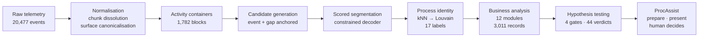
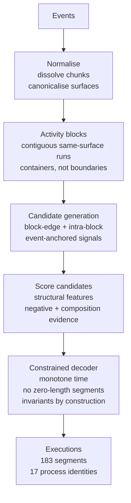
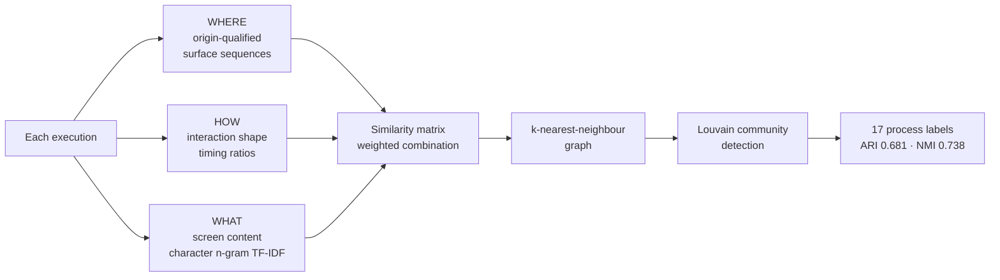
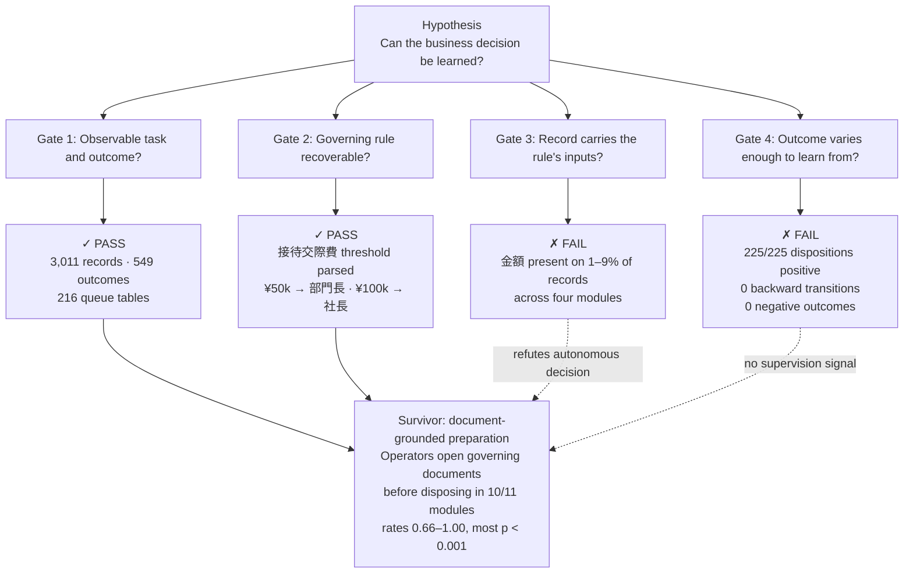
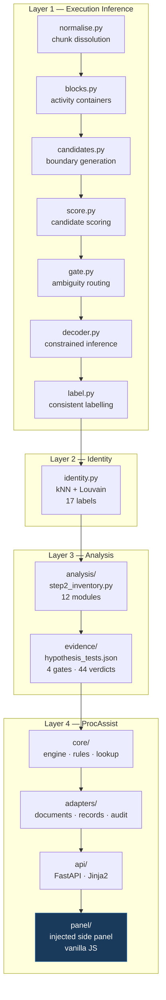

<p align="center">
  <strong>From Desktop Telemetry to a Document-Grounded AI Assistant</strong>
</p>

<p align="center">
  Recovering business-process executions from raw keystroke logs, discovering automation opportunities,<br/>
  testing the automation hypothesis against evidence, and shipping a working human-in-the-loop system.
</p>

<p align="center">
  <a href="#key-results">Results</a> · <a href="#procassist--the-delivered-product">ProcAssist</a> · <a href="#run-it">Run it</a> · <a href="FINAL_REPORT.md">Final Report</a> · <a href="docs/WORK_LOG.md">Work Log</a>
</p>

---

**Indrani Chattopadhyay** · IIT Bhubaneswar · Mechanical Engineering · indranichattopadhyay635@gmail.com

**Assignment:** 7-day AI Engineer / Forward-Deployed Engineer recruitment task · ~55 hours of recorded effort · 449 tests passing

---

## The problem

A Japanese company's desktop agent records every keystroke, click and application switch from back-office staff across HR, Finance and Logistics. Nothing in the stream says *what* work is being done — no process names, no case identifiers, no task boundaries. The logs had accumulated untouched.

> *"Use these logs to tell us where automation would have the greatest impact on our operations. And show us something that actually works."*

Two datasets: **Dataset A** (63 sessions, ~162k events, with ground truth) for building and validation. **Dataset B** (15 sessions, ~20k events, no ground truth, different departments and applications) — the production data to analyse. All screen text, process names and UI content are in Japanese.

---

## What I built

Not a single jump from logs to an AI agent. The work progressed through four layers, each earning the next:

1. **Execution inference** — recovered coherent units of work from raw event streams
2. **Process discovery** — identified recurring processes without any labels, using unsupervised learning
3. **Business analysis and hypothesis testing** — mapped the production dataset into a process inventory, then *tested* whether autonomous decision-making was justified by the evidence
4. **ProcAssist** — built the product around what survived the test: document-grounded decision *preparation*, not decision automation

The central engineering decision: **the attractive automation hypothesis was refuted by the data**, and the product was redesigned around what the evidence actually supported.

---

## Key results

| Measure | Value | Context |
|:---|:---|:---|
| Boundary F1 | **0.690** @ τ=2s | 2.67× the strongest of six baselines |
| Segment-count ratio | **0.98** | gains are not from over-segmenting |
| Candidate reachability | **88.0%** | against a measured ceiling of 90.0% |
| Process identity ARI | **0.681** | 17 discovered labels, no supervision on production data |
| Process identity NMI | **0.738** | homogeneity and completeness both rise at every step |
| Production modules discovered | **12** | across HR, Finance, Logistics — 3,011 records, 629 dispositions |
| Hypothesis gates passed | **2 of 4** | document-grounded preparation survives; autonomous decision does not |
| ProcAssist batch (HR queue) | 23 docs · 120 drafts · **0 dispositions** | the zero is the feature |
| Test suite | **449 passing**, 2 skipped | 366 test functions; 79 for the delivered product |

Every metric traces to a committed artifact under [`build/dataset_b/evidence/`](build/dataset_b/evidence/) or to the [final report](FINAL_REPORT.md).

---

## End-to-end flow



---

## Step 1 — execution inference

Given ~20,000 low-level events with no markers, recover where one piece of work ends and the next begins.



**The pivot that mattered.** Activity blocks were initially assumed to be natural execution boundaries. Measurement showed only **59.9%** of true boundaries fall at block edges. A dedicated experiment found the information survived at event level — adding intra-block candidates raised reachability to **88.0%** against a ceiling of **90.0%**.

An LLM adjudicator was designed, sized at **+0.026 F1** for perfect oracle performance, and declined — the deterministic scorer saturated before the LLM tier was needed.

> Full methodology: [STEP1_REPORT.md](docs/STEP1_REPORT.md) · [FINAL_REPORT.md §4–5](FINAL_REPORT.md)

---

## Step 1.5 — process identity without labels

Dataset B has no process codes. Dataset A's codes cannot transfer (different departments, different work). Identity must be *inferred*.



A language model was sized three times for label refinement and declined each time, each against a measured ceiling. A logistic regression over exactly the features the clusterer sees recovers the reference process code at **0.891 accuracy** — the residual is an unsupervised-objective gap, not a semantics gap.

---

## Step 2 — automation opportunity analysis

Applied to Dataset B, the pipeline produced a twelve-module inventory across three departments:

| Dept | Modules | Records | Dispositions |
|:---|:---:|:---:|:---:|
| HR | 4 | 1,305 | 266 |
| Finance | 4 | 593 | 195 |
| Logistics | 4 | 1,113 | 168 |

**A correction that mattered.** The initial analysis aggregated by URL route. Three different business systems serve the route `/payroll-items` — invoice approval, expense settlement and inventory management were merged into one "process family." The segmentation layer had never lost the distinction (70% of its distance metric is origin-qualified); the analysis layer destroyed it in one function. The analysis was re-performed from scratch, re-auditing 42 prior claims — **16 held, 11 were contradicted**.

A later measurement corrected the correction: the URL disagrees with the rendered screen header in **21% of captures**, while header and record-ID prefix agree on **2,904 of 2,904** records. A twelfth module had been missing from the route map entirely.

> Full analysis: [STEP2_AUTOMATION_OPPORTUNITY.md](docs/STEP2_AUTOMATION_OPPORTUNITY.md) · [STEP2_RESEARCH_REVIEW.pdf](docs/STEP2_RESEARCH_REVIEW.pdf)

---

## Step 2.5 — testing the automation hypothesis

The attractive hypothesis: *operators apply written rules to record variables, and an AI system can learn that decision function.*

Four gates were declared before the numbers were inspected:



**The two failures corroborate each other.** If the deciding variable is absent from 91–99% of records, the operator is not deciding from the record. With zero negative outcomes, a model trained here learns *approve* and scores 100% while being worth nothing.

**One genuine survivor.** Operators open a governing document before disposing at rates well above chance — supported in 10 of 11 modules, most at p < 0.001. The product target shifted from *predict the decision* to **prepare the decision context**.

> Full evidence: [STEP2_HYPOTHESIS_VERIFICATION.md](docs/STEP2_HYPOTHESIS_VERIFICATION.md) · [STEP3_TARGET_REFRAME.md](docs/STEP3_TARGET_REFRAME.md)

---

## ProcAssist — the delivered product

A panel mounted inside the business system the operator already uses. For each record it:

1. **Resolves** the governing regulation from a declared lookup (measured at 64.2%, CI 56.2–71.5%)
2. **Localises** the governing clause within the regulation
3. **Evaluates** the record against the clause's threshold tiers
4. **Drafts** the comment the operator would type — with the **judgement slot empty**
5. **Stops.** The human chooses. The human clicks their own system's submit button.

No code path can click submit. A test reads the panel source and fails if one appears.


### Status vocabulary

| Status | Meaning |
|:---|:---|
| `✓ OK` | One tier of the governing clause matches; required fields present |
| `⚠ FLAG` | The authority the clause requires exceeds this queue's declared ceiling |
| `! REQUIRES_REVIEW` | A rule governs this record but an input it needs is not on the screen |
| `? MISS` | No governing rule is established for this record type — proceed unaided |

No confidence scores. Four discrete statuses. `MISS` is a first-class outcome, not a fallback.

### Batch behaviour (HR expense queue)

| Before | After |
|:---|:---|
| 0 documents resolved | **23** documents resolved |
| 0 drafts staged | **120** drafts staged |
| — | 6–20 app switches avoided |
| — | 3,497 keystrokes avoided |
| — | 887 field look-ups avoided |
| 0 dispositions taken | **0 dispositions taken** |

### What it will not do

- No confidence scores — statuses only
- No LLM, no embeddings, no vector store, no model API
- No guessed document when the lookup misses
- No fabricated amount when a screen doesn't show one
- No absolute time or cost claim — waiting times were compressed in the capture environment

The impact calculator ships with its three inputs **empty**, because they are the client's numbers.

---

## Run it

### Prerequisites

- Python ≥ 3.10

### Setup

```bash
make setup          # creates .venv, installs procmine + dependencies
```

### Start ProcAssist

```bash
.venv/bin/python -m procassist.api
```

### Demo walkthrough

| Step | Action | What you see |
|:---|:---|:---|
| 1 | Open http://127.0.0.1:5132/payroll-items | 120 raw records, nothing resolved |
| 2 | Press **▶ エージェントで一括準備** | Every row resolves — statuses, regulations, drafts appear |
| 3 | Click the `⚠ FLAG` row `P1-07106250-010` | Panel names 接待交際費規程, quotes 第２条, explains why ¥135,181 needs 社長承認 |
| 4 | Press **下書きを使う** | Host comment field fills with the judgement slot *empty* |
| 5 | Click the judgement option | Comment completes byte-identically to what an operator typed |
| 6 | Click **登録確定** yourself | Only now does the success message appear |

### Three queues, three behaviours

| Queue | URL | Records | Demonstrates |
|:---|:---|:---:|:---|
| HR expense settlement | http://127.0.0.1:5132/payroll-items | 120 | OK / FLAG — threshold tiers evaluated |
| FI invoice approval | http://127.0.0.1:5133/payroll-items | 108 | **MISS** — no regulation governs an invoice amount |
| FI managerial approval | http://127.0.0.1:5133/leave-applications | 24 | **REQUIRES_REVIEW** — amount column absent |

### Optional: watch the retriever lose

```bash
PROCASSIST_CHALLENGER=1 .venv/bin/python -m procassist.api
```

Adds a local BM25 + character-3-gram retriever beside the deterministic lookup. On the FLAG record it **disagrees** — it matches the record's surface vocabulary to the noisiest part of the capture rather than to the governing clause.

### Reproduce the Step 1 deliverable

```bash
make run-b              # perception artifacts → segments.jsonl
make validate-segments  # check against the data contract
```

### Tests

```bash
.venv/bin/python -m pytest -q                           # full suite: 449 passing
.venv/bin/python -m pytest tests/test_procassist_*.py -q   # product only: 79 tests
```

---

## Architecture



### Technology stack

| Layer | Technology |
|:---|:---|
| Inference | Python 3.12 · NumPy · SciPy · scikit-learn · NetworkX · RapidFuzz · segeval |
| Product | FastAPI · Pydantic v2 · Jinja2 · SQLite · vanilla JS |
| Not used | No vector database · no model API · no agent framework · no external service |

**No data leaves the machine.** No API key, no model endpoint, no network call. For a Japanese client with personal-information-protection obligations, this is a design property.

---

## Engineering pivots

Three moments where measurement changed the plan:

**1. Blocks looked like execution boundaries — they weren't.**
Activity blocks capture "where the user is" but 40% of true process boundaries fall *inside* a block. Intra-block candidate generation, anchored on event-level signals, raised reachability from 59.9% to 88.0%.

**2. URL routes looked like business process identifiers — they weren't.**
Three different business functions serve `/payroll-items`. The segmentation layer's origin-qualified distances preserved the distinction; the analysis layer's route aggregation destroyed it. The analysis was re-performed from scratch.

**3. Highly repetitive work looked like a decision-automation candidate — it wasn't.**
225 of 225 observed dispositions were positive. The deciding variable appeared on 1–9% of records. A model trained here learns *approve* and scores 100% while being worth nothing. The product was redesigned around document-grounded preparation.

---

## Reports and evidence

| Artifact | Purpose |
|:---|:---|
| [**FINAL_REPORT.md**](FINAL_REPORT.md) | Complete methodology, architecture, evaluation, product design, impact model — **start here** |
| [**STEP2_RESEARCH_REVIEW.pdf**](docs/STEP2_RESEARCH_REVIEW.pdf) | Literature survey: task mining, process selection, Japanese public-sector evidence |
| [**STEP2_AUTOMATION_OPPORTUNITY.md**](docs/STEP2_AUTOMATION_OPPORTUNITY.md) | Production dataset analysis: 12 modules, effort, operators, variants, automation candidates |
| [**STEP2_HYPOTHESIS_VERIFICATION.md**](docs/STEP2_HYPOTHESIS_VERIFICATION.md) | Four-gate hypothesis test: 44 verdicts, the refutation, and what survived |
| [**STEP1_REPORT.md**](docs/STEP1_REPORT.md) | Segmentation methodology, evaluation protocol, baseline comparisons |
| [**WORK_LOG.md**](docs/WORK_LOG.md) | 7-day postmortem: hypotheses, experiments, eight pivots, time allocation |
| [**DECISIONS.md**](docs/DECISIONS.md) | Architecture Decision Records 001–025, append-only |
| [**procassist/README.md**](procassist/README.md) | ProcAssist: the demo path, the four cases, the audit trail |

Evidence artifacts every claim cites are committed under [`build/dataset_b/evidence/`](build/dataset_b/evidence/).

---

## Repository map

```
procmine/                     Step 1: segmentation and process identity
  normalise.py · blocks.py · candidates.py · score.py
  gate.py · decoder.py · identity.py · label.py
  evaluate.py · cli.py · schemas.py · baselines.py

procassist/                   Step 3: ProcAssist
  core/                       pure logic — engine, rules, lookup, comment, impact
  adapters/                   I/O — documents, records, audit (append-only, hash-chained)
  replica/                    business-system screen replicas (Jinja2 templates)
  panel/                      injected side panel (vanilla JS + CSS)
  api/                        FastAPI server, three-port layout
  challenger/                 local BM25 + char-3-gram retriever (off by default)
  i18n/                       JA→EN screen gloss
  measured/                   action budget measured from telemetry

analysis/                     Step 2 inventory, figures, reanalysis scripts
definitions/                  process declaration TOMLs — the artifact that executes
experiments/                  numbered experiments (E01, SE1–SE8)
tests/                        28 test modules, 449 tests
docs/                         all reports, ADRs, specifications, work logs
build/dataset_b/evidence/     committed evidence corpus
segments.jsonl                the Step 1 deliverable (183 segments)
FINAL_REPORT.md               the submission report
```

---

## Limitations

- **No ground truth on production data** — every claim about Dataset B is an inference, corroborated but never proven
- **Screen text covers 4.59% of events** — bounds every Layer 3 measurement (this is an evaluation limit; the product reads a live interface)
- **3 queues of 12 modules** — a shared foundation with declared definitions; remaining modules are visible, not hidden
- **No causal impact measurement** — operator interviews or an A/B test are needed to establish whether document surfacing changes the work, not just the keystrokes
- **The rejection branch was never observed** — the interface around FLAG is built for a case the corpus has never shown

The headline limitation: **the evidence establishes sequence, not causation.** The experiment that would settle it is named in the report and is the first thing that should be run.

---

<p align="center">
  <em>Use the right level of intelligence at the right layer.<br/>
  Infer where evidence supports inference. Withhold where evidence supports only a guess.<br/>
  And leave the irreversible action with the human.</em>
</p>
