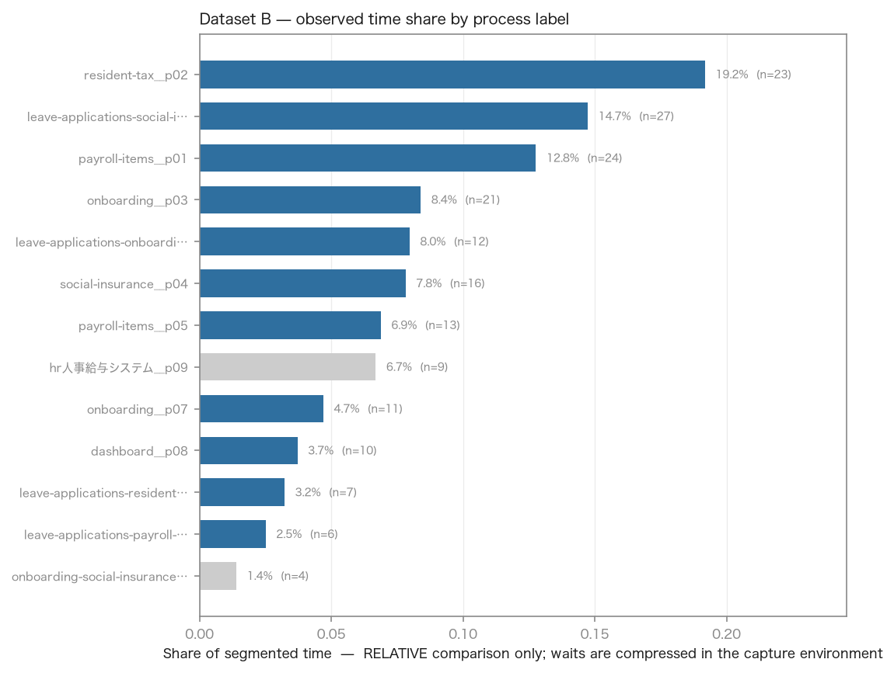
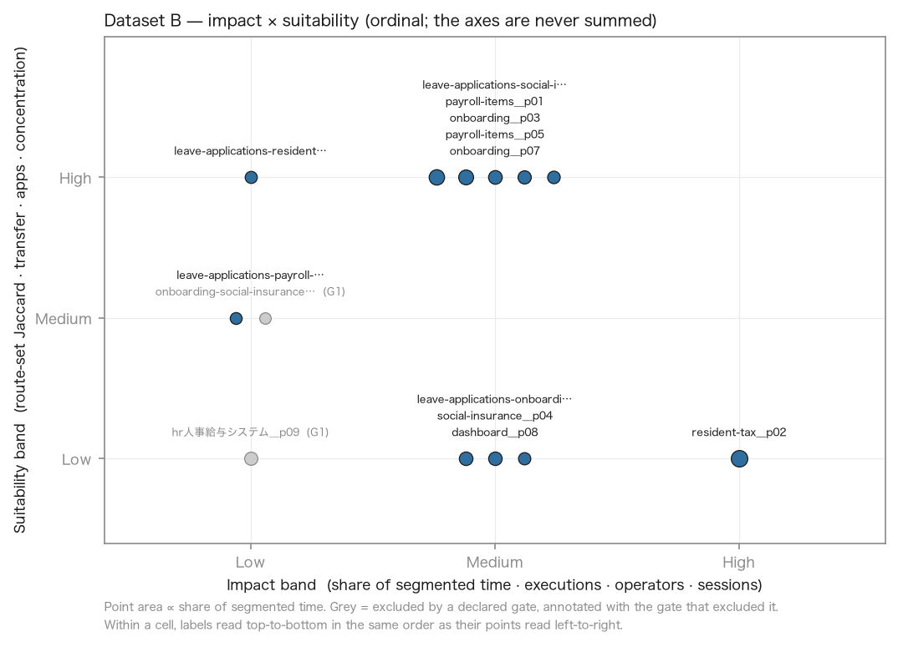
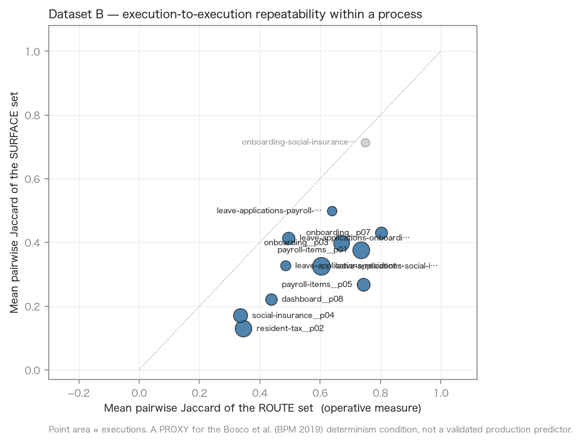

# Step 2 — Dataset B process inventory and automation-candidate analysis

Every number tagged `[DATASET]` was computed by `analysis/step2_inventory.py` from the frozen
Step 1 output and is reproducible with
`python -m analysis.step2_inventory --dataset dataset_b`. `[LIT]` / `[JP]` / `[VENDOR]` come from
`docs/STEP2_RESEARCH_REVIEW.md`. `[INF]` is our inference. Nothing here blurs the three.

---

## 1. What Step 2 must answer

`README.md`, *Step 2 — Analyze the work and identify automation candidates*:

> Apply your Step 1 approach to Dataset B, and analyze the operations based on its output.
>
> - What processes are performed, how often, and how much time do they consume?
> - How many people are involved?
> - Are there different handling patterns within the same process?
>
> Then, **propose which processes should be automated, in priority order.**
> Explain the reasoning behind that ordering.

Five asks: the process inventory, frequency, time, people, handling patterns — then a priority
order with its reasoning. §4 answers the four descriptive ones; §6–§8 and §11 give the order.

---

## 2. Method, and the limits on it

**Input.** `build/dataset_b/segments_rich.jsonl` — 183 executions, 13 process labels, 15
sessions — produced by the frozen Step 1 pipeline. `[DATASET]`

**Attribution is by event sequence, not block containment.** Each execution carries
`start_seq`/`end_seq` indexing the normalised event stream; events are attributed by that range
directly. Block-level fields (operator, element ids and labels, field keys, screenshots) are
joined by seq-range *overlap* with the block's `first_seq`/`last_seq`.

This is not a stylistic choice. Measured `[DATASET]`: block containment would attribute only
**12,620 of 14,809 events (85.2%)**, and the loss is wildly uneven — `payroll-items__p05`
averages **0.85** fully-contained blocks per execution and would lose **60.0%** of its events;
`leave-applications-payroll-items__p11` averages **0.67** and would lose **72.4%**. The two
labels most likely to be dismissed as small are exactly the two containment would shrink most.

**Three limits that bound every claim below.**

1. **Durations are relative only.** `README.md` states waiting time is compressed in the capture
   environment. Every duration in this report compares processes *with each other*. None of them
   is wall-clock effort, and no figure here should be multiplied by a wage. `[DATASET]`
2. **The sample is small and is one window.** 15 sessions, 4 operators, 7,642.7 s of segmented
   activity (127.4 minutes) inside 10,574.8 s of session span — **72.3% coverage**, consistent
   with ADR-020's finding that observed session time is not all process time. `[DATASET]`
3. **Step 1's measured accuracy does not transfer.** On Dataset A, Step 1 measured boundary F1
   **0.690** at τ=2 s and identity ARI **0.681** at match_rate **0.760**. **Dataset B has no
   ground truth.** Those are measurement limitations on the inventory — an unknown share of
   these executions is mis-bounded or mis-labelled — and they are *not* accuracy claims about
   anything in this report. `[DATASET]`

**What is deliberately not computed.** Labour cost, monetary ROI, FTE savings, business
criticality, compliance exposure, API availability, error/rework rate and true production volume
are **absent from this telemetry**. They are not estimated or imputed anywhere. They appear in
§10 as questions for the client. `[INF]`

**Determinism is a proxy.** Mean pairwise Jaccard of the route set within a process
operationalises the Bosco et al. (BPM 2019) condition that a routine's parameters be computable
from earlier ones `[LIT]` `STEP2_RESEARCH_REVIEW §3.2`. It is **a proxy, not a validated
production predictor**, and the surface-set measure is reported beside it. Exact
ordered-sequence equality is also reported, for completeness only — it is a harsh test, and the
route-set measure is the operative one.

**Dependency note.** Figures use `matplotlib`, which is not on the `ARCHITECTURE.md` §6 approved
list. `CLAUDE.md` §7 would normally require an ADR; `docs/DECISIONS.md` is frozen for this
phase, so the addition is recorded here and flagged for an ADR when that file is next writable.
It is an optional `analysis` extra, never on the Step 1 critical path.

---

## 3. Process inventory

All 13 labels, gated and ungated. `[DATASET]` throughout.
Apps column is `business / total` — see §3.1. Times are **relative comparison only**.

| Process label | n | sessions | ops | share of time | median s | IQR/med | apps | routes | clip/ex | form/ex | route Jacc | surf Jacc | route conc | elem ids | field keys | Impact | Suitability | Gates |
|---|---|---|---|---|---|---|---|---|---|---|---|---|---|---|---|---|---|---|
| `resident-tax__p02` | 23 | 12 | 4 | 19.2% | 56 | 0.43 | 5/10 | 7 | 6.7 | 5.0 | 0.35 | 0.13 | 0.78 | 12 | 28 | High | Low | pass |
| `leave-applications-social-insurance__p00` | 27 | 8 | 4 | 14.7% | 29 | 0.65 | 5/6 | 6 | 3.3 | 1.9 | 0.60 | 0.33 | 0.89 | 10 | 25 | Medium | High | pass |
| `payroll-items__p01` | 24 | 8 | 4 | 12.8% | 37 | 0.63 | 4/8 | 4 | 2.6 | 2.5 | 0.74 | 0.38 | 1.00 | 6 | 39 | Medium | High | pass |
| `onboarding__p03` | 21 | 8 | 4 | 8.4% | 28 | 0.42 | 2/2 | 7 | 2.6 | 1.9 | 0.67 | 0.40 | 1.00 | 9 | 17 | Medium | High | pass |
| `leave-applications-onboarding__p06` | 12 | 4 | 2 | 8.0% | 38 | 0.58 | 3/4 | 5 | 4.8 | 3.5 | 0.49 | 0.41 | 0.92 | 8 | 11 | Medium | Low | pass |
| `social-insurance__p04` | 16 | 11 | 4 | 7.8% | 29 | 0.73 | 5/7 | 7 | 2.9 | 2.1 | 0.33 | 0.17 | 0.69 | 9 | 23 | Medium | Low | pass |
| `payroll-items__p05` | 13 | 5 | 3 | 6.9% | 42 | 0.33 | 4/5 | 3 | 4.1 | 4.0 | 0.74 | 0.27 | 1.00 | 4 | 8 | Medium | High | pass |
| `hr人事給与システム__p09` | 9 | 1 | 1 | 6.7% | 70 | 0.71 | 5/7 | 0 | 5.1 | 0.0 | n/a | 0.24 | 0.00 | 0 | 13 | Low | Low | **FAIL** |
| `onboarding__p07` | 11 | 5 | 3 | 4.7% | 26 | 0.92 | 2/5 | 3 | 2.7 | 1.6 | 0.80 | 0.43 | 1.00 | 2 | 13 | Medium | High | pass |
| `dashboard__p08` | 10 | 7 | 4 | 3.7% | 21 | 0.38 | 2/6 | 3 | 0.8 | 0.2 | 0.44 | 0.22 | 0.70 | 4 | 11 | Medium | Low | pass |
| `leave-applications-resident-tax__p10` | 7 | 6 | 4 | 3.2% | 38 | 0.29 | 2/2 | 5 | 3.4 | 3.4 | 0.48 | 0.33 | 1.00 | 6 | 8 | Low | High | pass |
| `leave-applications-payroll-items__p11` | 6 | 4 | 2 | 2.5% | 27 | 0.63 | 3/3 | 4 | 3.2 | 3.3 | 0.64 | 0.50 | 1.00 | 4 | 4 | Low | Medium | pass |
| `onboarding-social-insurance__p12` | 4 | 1 | 1 | 1.4% | 23 | 0.15 | 3/3 | 2 | 1.2 | 1.2 | 0.75 | 0.71 | 1.00 | 4 | 12 | Low | Medium | **FAIL** |
Totals `[DATASET]`: **183 executions · 13 labels · 15 sessions · 4 operators · 7,642.7 s
segmented** across **11 route families**.



### 3.1 Two measurement caveats found while validating, not after

**Application counts are inflated by capture and OS shells.** `resident-tax__p02` shows 10
distinct applications, of which only 5 are business systems; the other five are
`procmine-desktop-agent` (the recorder itself, appearing in 2 labels), `prl_cc` (the VM control
centre, 4 labels), `OpenWith`, `WindowsTerminal` and `Windows Explorer`. Both counts are
reported. **The suitability band still uses the declared `distinct_apps`**, because the band
boundaries were fixed before the numbers were seen and re-tuning them afterwards would make the
banding unfalsifiable. The effect is conservative — it penalises multi-shell labels — and the
labels it penalises are named here so a reader can discount it. `[DATASET]`

**Absence of evidence is reported as absence.** `hr人事給与システム__p09` has **zero** routes. The
Jaccard convention for two empty sets is 1.0, which would have printed as perfect determinism
for a label with no route evidence at all; the script returns `null` instead. Caught by reading
the output, not by the exit code. `[DATASET]`

---

## 4. Frequency, effort, people, variants — the README's four questions

### What processes are performed, and how often?

Eleven route families over five portal modules — leave applications, onboarding, payroll items,
resident tax, social insurance — plus a dashboard label and one Japanese-titled HR-system label.
Six labels are **cross-module**: an execution that starts in one module and finishes in another
(`leave-applications-social-insurance`, `leave-applications-onboarding`,
`leave-applications-resident-tax`, `leave-applications-payroll-items`,
`onboarding-social-insurance`). Those six account for **56 of 183 executions (30.6%)** and
**29.8% of segmented time**. `[DATASET]`

`[INF]` Cross-module executions are where a human is acting as the integration layer between two
screens of the same portal. `STEP2_RESEARCH_REVIEW §8` routes that observation to *workflow
orchestration* or *process redesign*, not automatically to RPA.

### How much time do they consume?

`resident-tax__p02` is the largest single consumer at **19.2%** of segmented time from 23
executions, with the longest median execution (**56 s** against a dataset median nearer 30 s).
The top three labels take **46.7%** of segmented time. `[DATASET]`
**Relative comparison only** — waits are compressed in the capture environment.

### How many people are involved?

**Four operators** in the whole dataset. **Nine of 13 labels involve 3 or 4 of them**; only
`hr人事給与システム__p09` and `onboarding-social-insurance__p12` are single-operator, and both fail
the evidence gate on exactly that. `[DATASET]`

`[INF]` With a pool of four, "people affected" cannot discriminate much: it is close to a
constant across the surviving labels, so it carries little ranking weight here even though
`STEP2_RESEARCH_REVIEW §5` lists it as a value criterion.

### Are there different handling patterns within the same process?

Yes, and Step 1's labelling separated two of them without being asked to. `[DATASET]`

| Family | Variant | n | median s | business apps | routes | clip/ex | form/ex | keys/ex | transitions/ex | route Jacc |
|---|---|---|---|---|---|---|---|---|---|---|
| payroll-items | `__p01` | 24 | 37 | 4 | 4 | 2.6 | 2.5 | 19.0 | 5.2 | 0.74 |
| payroll-items | `__p05` | 13 | 42 | 4 | 3 | 4.1 | 4.0 | 9.1 | 1.5 | 0.74 |
| onboarding | `__p03` | 21 | 28 | 2 | 7 | 2.6 | 1.9 | 12.4 | 4.8 | 0.67 |
| onboarding | `__p07` | 11 | 26 | 2 | 3 | 2.7 | 1.6 | 17.5 | 4.5 | 0.80 |

**The payroll-items split is the clearest and it is not noise.** `__p01` types roughly twice as
much (19.0 vs 9.1 keystrokes per execution) and moves between surfaces 3.5× as often (5.2 vs
1.5 transitions); `__p05` copies and form-fills roughly 1.6× as much (4.1 vs 2.6 clipboard, 4.0
vs 2.5 form inputs) while staying nearly put. `[INF]` That reads as **transcribe-by-typing**
versus **transfer-by-copy** — two handling patterns for the same business step. They have
near-identical route determinism (0.74 both), so neither is the "messy" one.

`[INF]` This matters for Step 3 scope: an automation built only around `__p01`'s typing pattern
would not fire on the 13 `__p05` executions, and vice versa. It is an argument for targeting the
*business step* with two entry paths rather than one observed pattern.

---

## 5. Gates: what was excluded, and on which number

Declared **before** the numbers were inspected, and not tuned afterwards.
Full detail with the deciding number per label: `build/dataset_b/step2/gates.json`.

| Gate | Rule |
|---|---|
| **G1** evidence sufficiency | `n_executions >= 5 AND n_sessions >= 3 AND n_operators >= 2` |
| **G2** is business work | `NOT (portal-root/dashboard navigation AND form_inputs/ex < 0.5 AND clipboard/ex < 1.0)` |
| **G3** has a target surface | `distinct_routes >= 1 AND distinct_element_ids >= 1` |

**Two labels excluded, both on G1** `[DATASET]`:

- `hr人事給与システム__p09` — `n_sessions=1 < 3; n_operators=1 < 2`. Also fails **G3**
  (`distinct_routes=0, distinct_element_ids=0`): it is an application window with no web route
  and no recovered widget, so there is nothing to target even in principle.
- `onboarding-social-insurance__p12` — `n_executions=4 < 5; n_sessions=1 < 3; n_operators=1 < 2`.
  Passes G2 and G3; it is simply one person's work observed once.

**G2 excluded nothing, and the near-miss is worth stating plainly.** `dashboard__p08` has
`form_inputs/ex = 0.2` and `clipboard/ex = 0.8` — **both below the thresholds** — and survives
only because its route set is `['/dashboard', '/payroll-items', '/social-insurance']`, so *not
all* its routes are navigational. Had the rule been written on the *modal* route rather than
*all* routes, it would have failed. The rule stands as declared; this report does not retune a
gate after seeing which process it catches. `[DATASET]` `[INF]` Treat `dashboard__p08` as
navigation overhead that the gate did not catch, not as a candidate.

---

## 6. Impact × suitability

Two ordinal axes. **They are never summed**, and no composite score exists anywhere in the
output — `STEP2_RESEARCH_REVIEW §3.3` records frequency-versus-automability and
value-versus-suitability as genuine tensions in the evidence, and netting them into one number
hides which side carried the answer.

**Band boundaries, stated.** A label's band is the majority of its component bands, ties broken
downward.

| Axis | Component | High | Medium | Low |
|---|---|---|---|---|
| **Impact** | share of segmented time | ≥ 0.15 | ≥ 0.07 | < 0.07 |
| | executions | ≥ 20 | ≥ 10 | < 10 |
| | operators | ≥ 3 | ≥ 2 | < 2 |
| | sessions | ≥ 10 | ≥ 5 | < 5 |
| **Suitability** | route-set Jaccard | ≥ 0.85 | ≥ 0.60 | < 0.60 |
| | clipboard + form inputs per execution | ≥ 2.0 | ≥ 0.5 | < 0.5 |
| | distinct applications *(fewer is better)* | ≤ 2 | ≤ 3 | > 3 |
| | route concentration | ≥ 0.80 | ≥ 0.60 | < 0.60 |




**The headline of the matrix** `[DATASET]`: the largest process by time is the *least* suitable.
`resident-tax__p02` is the only **High** impact label (19.2% of time, 23 executions, 4 operators,
12 sessions) and it bands **Low** on suitability — route-set Jaccard **0.35**, seven distinct
routes, ten applications. Six labels band **High** on suitability and none of them bands High on
impact. `[INF]` This is exactly the pattern the research review predicted: *"Frequency sizes the
prize; it must never be the ranking"* `[LIT]` `§3.3`.

**No process in Dataset B reaches High on both axes.** Any recommendation is therefore a trade,
and §11 makes it explicitly rather than hiding it behind a total.

---

## 7. Shortlist

Four candidates. The order is argued in §11 and is a human judgement, not a script output.

### 7.1 `leave-applications-social-insurance__p00` — Impact Medium · Suitability High

**Why it makes the list** `[DATASET]`: the highest execution count in the dataset (**27**), 14.7%
of segmented time, **all 4 operators**, 8 sessions; route concentration **0.89**; transfer
signature 3.3 clipboard + 1.9 form inputs per execution; 10 distinct element ids and 25 field
keys recovered.

**Why it may fail** `[INF]`: route-set Jaccard is **0.60** — the bottom of the High band — and it
spans two portal modules across 6 routes, so the "one routine" framing may be wrong: it may be
two routines that happen to adjoin. Surface-set Jaccard is only **0.33**, meaning the *screens*
vary far more than the *routes*, which is a warning that the steps inside differ.

**Missing evidence**: whether the leave-application → social-insurance handoff is one business
procedure or two; whether the social-insurance write is reversible; volume outside this window.

### 7.2 `payroll-items__p01` — Impact Medium · Suitability High

**Why it makes the list** `[DATASET]`: 24 executions, 12.8% of segmented time, all 4 operators,
**route concentration 1.00**, route-set Jaccard **0.74** — the joint-highest determinism among
labels with meaningful volume — and **39 distinct field keys**, the richest field-level evidence
in the dataset.

**Why it may fail** `[INF]`: 8 applications (4 business), and a measured **variant split** —
`__p05` is the same family with a different handling pattern (§4). Automating `__p01` alone
addresses 24 of the family's 37 executions. Surface-set Jaccard 0.38 against route Jaccard 0.74
says the route is stable but the screens visited along it are not.

**Missing evidence**: whether `__p01`/`__p05` are one procedure done two ways or two procedures;
whether the payroll system exposes a bulk import that would make UI automation unnecessary.

### 7.3 `onboarding__p03` — Impact Medium · Suitability High

**Why it makes the list** `[DATASET]`: **2 applications only** (Edge + Word) — the cleanest
system footprint in the dataset — 21 executions, 8.4% of time, all 4 operators, route
concentration **1.00**, 9 element ids and 17 field keys.

**Why it may fail** `[INF]`: **7 distinct routes**, the joint-widest route spread, with route-set
Jaccard **0.67**. A process that touches every module in the portal is either a genuine
end-to-end onboarding flow or a segmentation artifact where Step 1 merged adjacent work. With no
ground truth on B we cannot tell which, and the 0.690/0.681 Step 1 figures are the relevant
uncertainty.

**Missing evidence**: whether onboarding genuinely traverses all five modules; what the Word
document contributes (source of record, or output?).

### 7.4 `payroll-items__p05` — Impact Medium · Suitability High

**Why it makes the list** `[DATASET]`: the **strongest transfer signature among suitable
labels** — 4.1 clipboard + 4.0 form inputs per execution, i.e. ~8 transfer operations per
execution — with route concentration **1.00**, route-set Jaccard **0.74**, and the *lowest*
transition count in the dataset (1.5 per execution). It sits still and copies. `[LIT]` That is
the closest thing in Dataset B to Bosco et al.'s deterministic-parameter routine.

**Why it may fail** `[DATASET]`: only 13 executions across 5 sessions and **3** operators, and
2.5× smaller by time than `__p01`. It passes G1 with margin on none of its three clauses.

**Missing evidence**: the same as §7.2, plus whether the copy source is a system of record or an
ad-hoc spreadsheet.

---

## 8. Eliminated, one paragraph each

**`resident-tax__p02` — eliminated on suitability, not on size.** It is the biggest process in
the dataset (19.2% of time, 23 executions) and bands **Low** on suitability: route-set Jaccard
**0.35**, the lowest of any label with volume; surface-set Jaccard **0.13**, the lowest in the
dataset outright; seven routes; ten applications (five business). `[INF]` Two executions of this
label barely resemble each other. Under the Bosco et al. condition `[LIT]` it is the weakest
candidate in the dataset despite being the largest prize — and it is the single most likely
process to be *worth* automating after redesign (`[JP]` MIC's 業務の整理・見直し), which is a
different recommendation from automating it as-is.

**`social-insurance__p04` — eliminated on determinism.** 16 executions and 11 sessions (good
spread), but route-set Jaccard **0.33** across 7 routes with route concentration **0.69**. The
same objection as `resident-tax__p02` at half the size.

**`leave-applications-onboarding__p06` — eliminated on determinism and operator spread.** A
strong transfer signature (4.75 clipboard + 3.50 form inputs, the highest in the dataset) and 8.0%
of time, but route-set Jaccard **0.49** and only **2 operators** across 4 sessions. `[INF]` It
would be the first candidate to revisit if the client confirms it is one procedure: the transfer
signature is exactly what we are looking for.

**`onboarding__p07` — eliminated on volume, not quality.** Route-set Jaccard **0.80** is the
highest in the dataset and route concentration is 1.00, but it is 11 executions and 4.7% of
time, and it is the smaller variant of a family whose larger variant is already shortlisted.

**`dashboard__p08` — navigation overhead.** 0.8 clipboard and 0.2 form inputs per execution,
route-set Jaccard 0.44. It survived G2 on a technicality (§5); it is not business work.

**`leave-applications-resident-tax__p10` and `leave-applications-payroll-items__p11` —
eliminated on evidence.** 7 and 6 executions respectively. Both pass G1, both show high transfer
signatures (3.4 and 3.2 clipboard per execution) and perfect route concentration. `[INF]` They
are too thin to rank, not demonstrated to be unsuitable.

**`hr人事給与システム__p09` and `onboarding-social-insurance__p12` — failed G1**, on the numbers in §5.

---

## 9. Target-system observability — can Step 3 be built without production access?

`[DATASET]` Recovered per candidate, from block evidence joined by seq overlap:

| Candidate | element ids | element labels | field keys | value hashes | screenshots |
|---|---|---|---|---|---|
| `leave-applications-social-insurance__p00` | 10 | 5 | 25 | 88 | 419 |
| `payroll-items__p01` | 6 | 3 | 39 | 68 | 309 |
| `onboarding__p03` | 9 | 4 | 17 | 45 | 273 |
| `payroll-items__p05` | 4 | 2 | 8 | 33 | 76 |

**The most consequential finding in this report is in the element ids.** `[DATASET]` The entire
dataset contains just **12 distinct element ids**, and they follow one strict convention:

```
btn-la-ok  btn-ob-ok  btn-pi-ok  btn-rt-ok  btn-si-ok        main
la-note    ob-note    pi-note    rt-note    si-note          rt-table
```

`btn-{module}-ok` and `{module}-note`, where module ∈ {la, ob, pi, rt, si} — exactly the five
portal modules. `btn-pi-ok` and `pi-note` each appear in **9 of 13** labels. `[INF]` These are
not five systems. They are **one web application with a uniform widget-naming convention**, and
the "cross-system" complexity visible in the app counts is largely Edge plus Word plus OS shells,
not five integrations.

**What this implies for Step 3** `[INF]`: a selector-level automation surface exists and is
recoverable from the logs alone — stable ids, 8–39 field keys per candidate, and value hashes
that let a transfer be verified without knowing the values. A single parameterised shell over
`btn-{module}-ok` / `{module}-note` would cover all five modules; `README.md` explicitly frames
that breadth-versus-depth choice as part of the ROI question. **What is not recoverable** is
whether any of it is stable in production, whether an API exists, and whether the portal in the
capture environment resembles the client's. Those are §10.

---

## 10. Missing evidence — client validation questions

Carried from `STEP2_RESEARCH_REVIEW §7`. None of these is estimated anywhere in this report.

1. What is the fully loaded hourly cost of the staff performing this work?
2. What is the true annual volume, and how seasonal is it? Our window is ~2 hours of activity.
3. **Do the target systems expose an API or a bulk import, making UI automation unnecessary?**
   `[INF]` Given §9 — one application, uniform ids — this is the question most likely to change
   the recommendation outright.
4. What is the error/rework rate today, and what does a wrong record cost downstream?
5. What statutory or audit obligations attach to this process? Resident tax and social insurance
   are both statutory domains in Japan `[INF]`, so this is not a formality.
6. How often do these screens change, and who owns them? `[LIT]` Syed et al.: UI changes force
   bot rework.
7. Who would own and maintain the automation? `[JP]` The 野良ロボット problem is governance, not
   engineering.

Two more this dataset raised specifically `[DATASET]`:

8. Are `payroll-items__p01` and `__p05` one procedure done two ways, or two procedures? The
   answer changes the scope of any payroll automation by 35% of its executions.
9. Does onboarding genuinely traverse all five portal modules, or did Step 1 merge adjacent work?
   `onboarding__p03`'s seven routes are either its defining feature or a segmentation error, and
   with no ground truth on B we cannot distinguish them.

---

## 11. Business judgement

**This section is a human decision recorded here. It is not an output of
`analysis/step2_inventory.py`,** which deliberately stops at evidence, gates and ordinal bands.

**Proposed priority order.**

1. **`payroll-items` as a family (`__p01` + `__p05`, 37 executions, 19.6% of segmented time).**
   Not `__p01` alone. The two variants share route determinism (0.74) and perfect route
   concentration and differ only in *how the data gets in* — typing versus copying. Targeting the
   business step with two entry paths covers 35% more executions than targeting the observed
   pattern, and the variant evidence in §4 is what makes that scope defensible rather than
   ambitious.
2. **`leave-applications-social-insurance__p00` (27 executions, 14.7%).** The most-executed label,
   all four operators, strongest observability (10 ids, 25 field keys). Ranked second, not first,
   because its surface-set Jaccard of 0.33 against route Jaccard of 0.60 is the report's clearest
   signal that the screens inside vary — and because if question 8 in §10 resolves the payroll
   variants into one procedure, that candidate is strictly better evidenced.
3. **`onboarding__p03` (21 executions, 8.4%).** Cleanest system footprint in the dataset — two
   applications — but its seven routes are unresolved (question 9). Ranked third *because of an
   open question*, not because of a measured weakness.
4. **`resident-tax__p02` — recommended for redesign, not automation.** The largest process in the
   dataset, and the least repeatable thing in it. `[JP]` MIC's position is that success requires
   業務の整理・見直し rather than RPA over an unexamined process, and this is the clearest instance of
   it in the data. Automating it as-is would encode 23 mutually dissimilar execution paths.

**What this ordering rests on, and what would overturn it.** It rests on repeatability and
observability, with volume sizing the prize rather than setting the order — the position the
research review argues from `[LIT]` `[JP]` and the reason no composite score appears anywhere in
this analysis. **It would be overturned by**: an API on the payroll module (question 3), which
would make UI automation the wrong modality entirely; a client answer that the payroll variants
are separate procedures (question 8), which would drop candidate 1 below candidate 2; or true
volumes that differ from this two-hour window (question 2), which could reorder everything.

**Modality, provisionally** `[INF]`, per `STEP2_RESEARCH_REVIEW §8`: candidate 1 shows high
repeatability, deterministic-looking parameters, structured fields and no observed API →
*deterministic UI automation*, **conditional on question 3**. Candidate 2 spans two modules with
a human acting as the link → *workflow orchestration*. Candidate 4 → *redesign first*.

**What this report does not claim.** That any process should be automated on volume alone; any
monetary or FTE figure; that Dataset B represents the client's full workload; that our
determinism measure is a validated production predictor — it is a proxy for the Bosco et al.
condition `[LIT]` `§3.2`; or that Step 1's Dataset A accuracy transfers to these labels.
